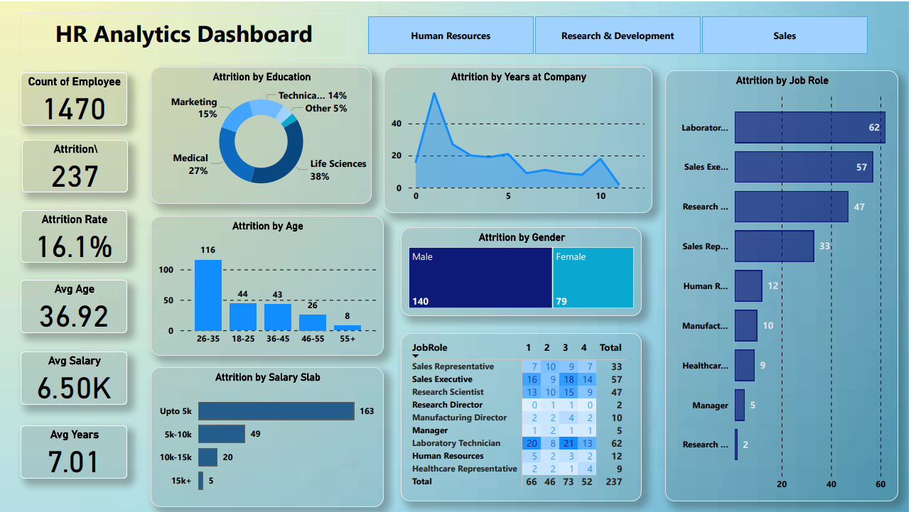

# HR Employee Attrition Analysis | Power BI Dashboard

## Project Overview

The **HR Employee Attrition Analysis** project focuses on analyzing employee attrition patterns and workforce metrics using Microsoft Power BI. The interactive dashboard provides insights into employee turnover across different age groups, departments, job roles, education fields, salary slabs, and years at the company.

The objective is to present key HR metrics in an interactive and easy-to-understand format to support workforce analysis and data-driven decision-making.

## Dashboard Preview

## Key Performance Indicators (KPIs)

- **Total Employees:** 1,470
- **Employees Who Left:** 237
- **Attrition Rate:** 16.12%
- **Average Employee Age:** 36.92 years
- **Average Monthly Salary:** 6.50K
- **Average Years at Company:** 7.01 years

## Dashboard Features

- **KPI Cards:** Display key workforce metrics, including employee count, attrition, attrition rate, average age, salary, and tenure.
- **Attrition by Age Group:** Analyze employee exits across different age groups.
- **Attrition by Job Role:** Compare attrition counts across job roles.
- **Attrition by Education Field:** Explore attrition patterns by educational background.
- **Attrition by Salary Slab:** Examine attrition counts across salary categories.
- **Attrition by Years at Company:** Understand how employee exits vary with tenure.
- **Gender-Based Analysis:** Compare attrition across gender categories.
- **Department-Level Navigation:** Explore workforce metrics across Human Resources (HR), Research & Development (R&D), and Sales.
- **Interactive Slicers:** Filter dashboard data for more focused analysis.

## Key Business Insights

- **Overall Attrition:** The organization recorded 237 employee exits out of 1,470 employees, representing an overall attrition rate of 16.12%.
- **Age-Based Analysis:** The 26–35 age group accounted for 116 attrition cases in the dashboard.
- **Job Role Analysis:** Laboratory Technicians and Sales Executives were among the job roles with notable attrition counts.
- **Salary Analysis:** The dashboard highlights attrition patterns across different salary slabs, including the category of up to 5K.
- **Departmental Analysis:** Department-level navigation enables users to explore workforce metrics across HR, R&D, and Sales.

## Tools & Technologies

- Microsoft Power BI
- Microsoft Excel
- Data Visualization
- Exploratory Data Analysis
- KPI Reporting
- Interactive Dashboard Design

## My Contribution

As part of a collaborative project, my primary contribution focused on developing the Power BI dashboard and presenting employee attrition metrics through interactive visualizations.

- Developed dashboard visuals to analyze employee attrition patterns.
- Created KPI cards to present key workforce metrics.
- Incorporated interactive slicers and department-level navigation.
- Designed visualizations covering age groups, job roles, education fields, salary slabs, gender, and years at the company.
- Presented workforce data in a structured, visual format to support business analysis.

## Project Outcome

Developed an interactive HR analytics dashboard that consolidates key workforce metrics and enables users to explore employee attrition patterns across multiple dimensions.

